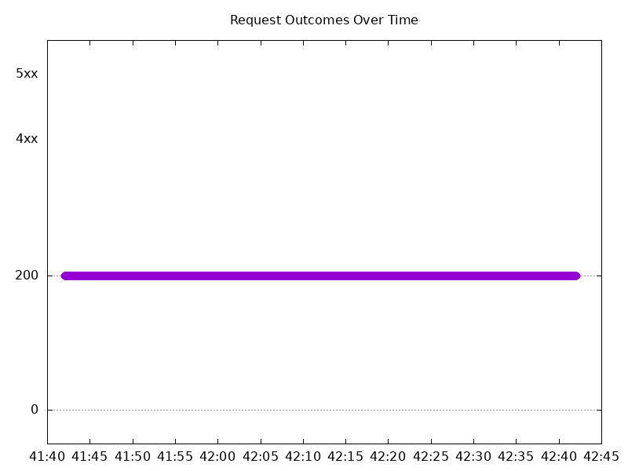

# Results

## Test environment

NGINX Plus: false

NGINX Gateway Fabric:

- Commit: 3739d7155e0ea1dc7067b70da5b13d36e09cdec6
- Date: 2026-10-19T16:12:46Z
- Dirty: false

GKE Cluster:

- Node count: 12
- k8s version: v1.36.4-gke.1391002
- vCPUs per node: 16
- RAM per node: 65848244Ki
- Max pods per node: 110
- Zone: us-west1-b
- Instance Type: n2d-standard-16

## Test: Send http /coffee traffic

```text
Requests      [total, rate, throughput]         6000, 100.02, 100.01
Duration      [total, attack, wait]             59.991s, 59.99s, 914.882µs
Latencies     [min, mean, 50, 90, 95, 99, max]  640.646µs, 909.09µs, 873.054µs, 1.103ms, 1.175ms, 1.384ms, 5.08ms
Bytes In      [total, mean]                     954000, 159.00
Bytes Out     [total, mean]                     0, 0.00
Success       [ratio]                           100.00%
Status Codes  [code:count]                      200:6000  
Error Set:
```



## Test: Send https /tea traffic

```text
Requests      [total, rate, throughput]         6000, 100.02, 100.01
Duration      [total, attack, wait]             59.992s, 59.99s, 1.232ms
Latencies     [min, mean, 50, 90, 95, 99, max]  573.055µs, 940.316µs, 932.844µs, 1.124ms, 1.198ms, 1.375ms, 10.878ms
Bytes In      [total, mean]                     918000, 153.00
Bytes Out     [total, mean]                     0, 0.00
Success       [ratio]                           100.00%
Status Codes  [code:count]                      200:6000  
Error Set:
```


