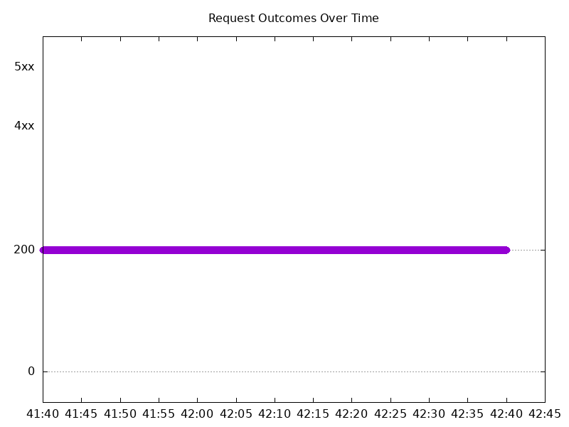

# Results

## Test environment

NGINX Plus: true

NGINX Gateway Fabric:

- Commit: 3739d7155e0ea1dc7067b70da5b13d36e09cdec6
- Date: 2026-10-19T16:12:46Z
- Dirty: false

GKE Cluster:

- Node count: 12
- k8s version: v1.36.4-gke.1391002
- vCPUs per node: 16
- RAM per node: 65848248Ki
- Max pods per node: 110
- Zone: us-west1-b
- Instance Type: n2d-standard-16

## Test: Send http /coffee traffic

```text
Requests      [total, rate, throughput]         6000, 100.02, 100.01
Duration      [total, attack, wait]             59.991s, 59.991s, 856.482µs
Latencies     [min, mean, 50, 90, 95, 99, max]  669.62µs, 972.347µs, 963.584µs, 1.102ms, 1.148ms, 1.311ms, 3.365ms
Bytes In      [total, mean]                     954000, 159.00
Bytes Out     [total, mean]                     0, 0.00
Success       [ratio]                           100.00%
Status Codes  [code:count]                      200:6000  
Error Set:
```



## Test: Send https /tea traffic

```text
Requests      [total, rate, throughput]         6000, 100.02, 100.01
Duration      [total, attack, wait]             59.992s, 59.991s, 1.075ms
Latencies     [min, mean, 50, 90, 95, 99, max]  700.055µs, 1.049ms, 1.031ms, 1.188ms, 1.248ms, 1.455ms, 10.708ms
Bytes In      [total, mean]                     918000, 153.00
Bytes Out     [total, mean]                     0, 0.00
Success       [ratio]                           100.00%
Status Codes  [code:count]                      200:6000  
Error Set:
```


