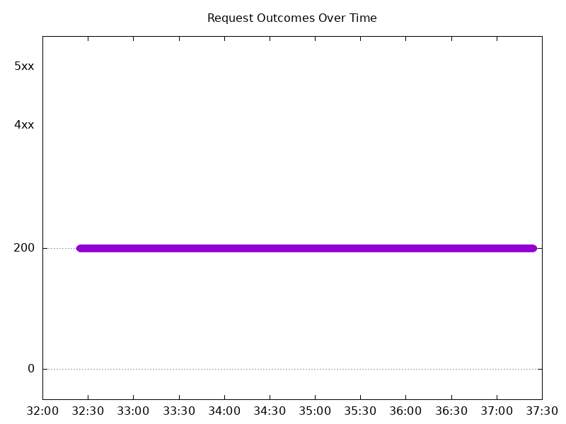
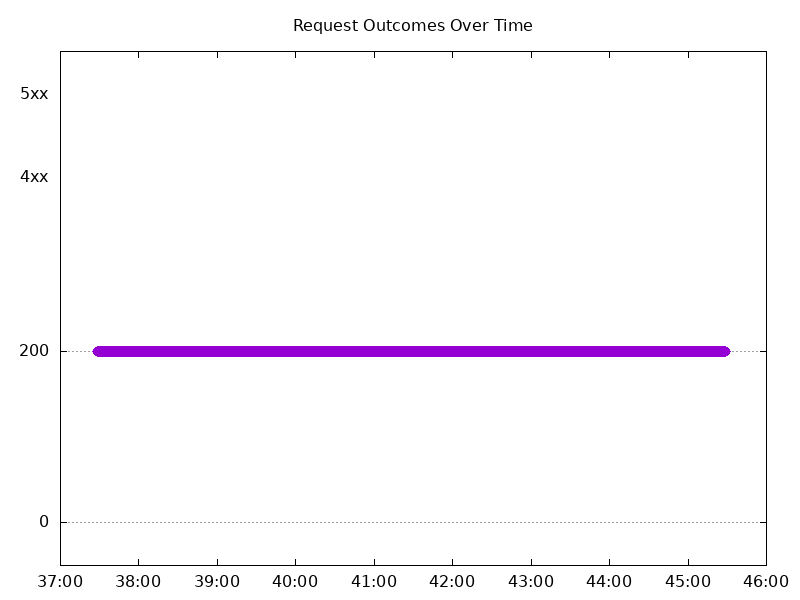
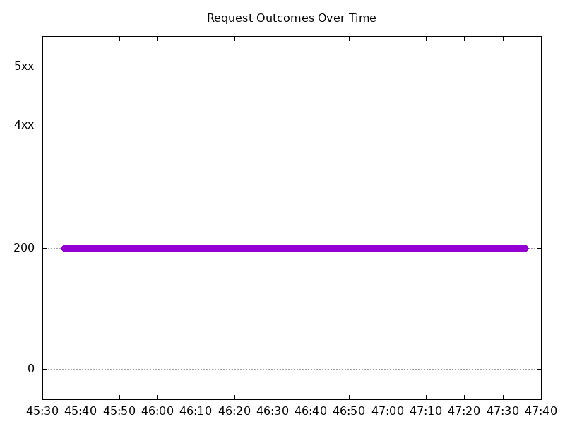
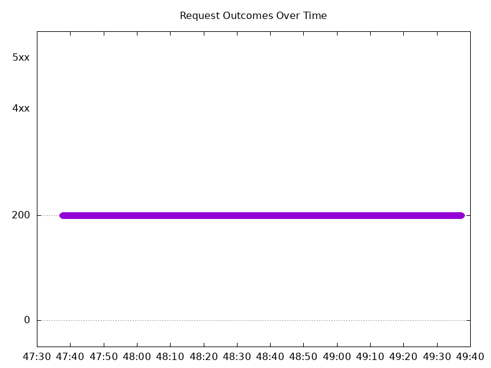
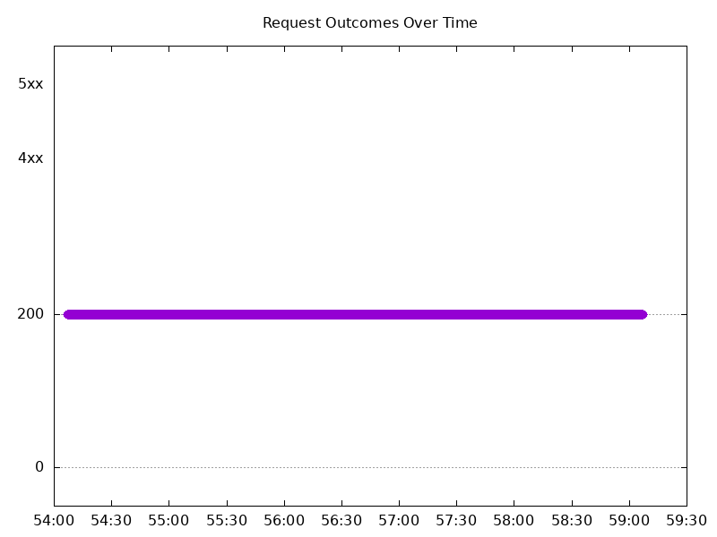
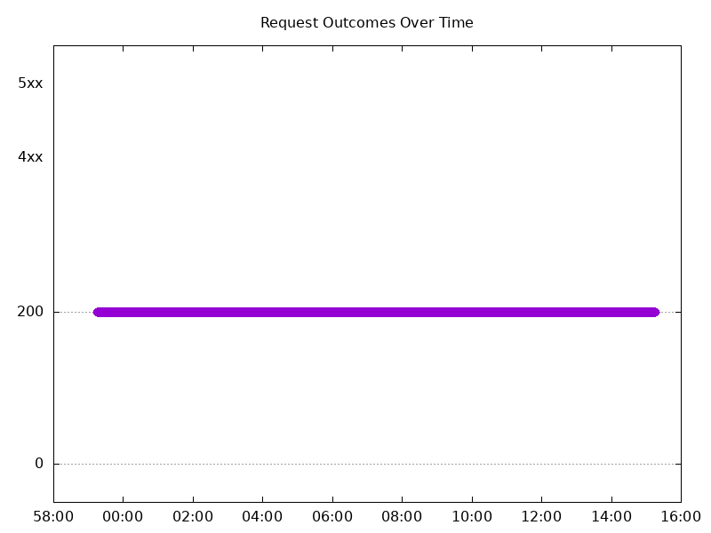
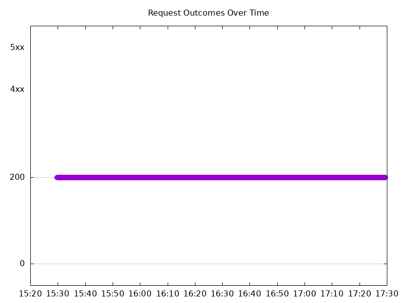
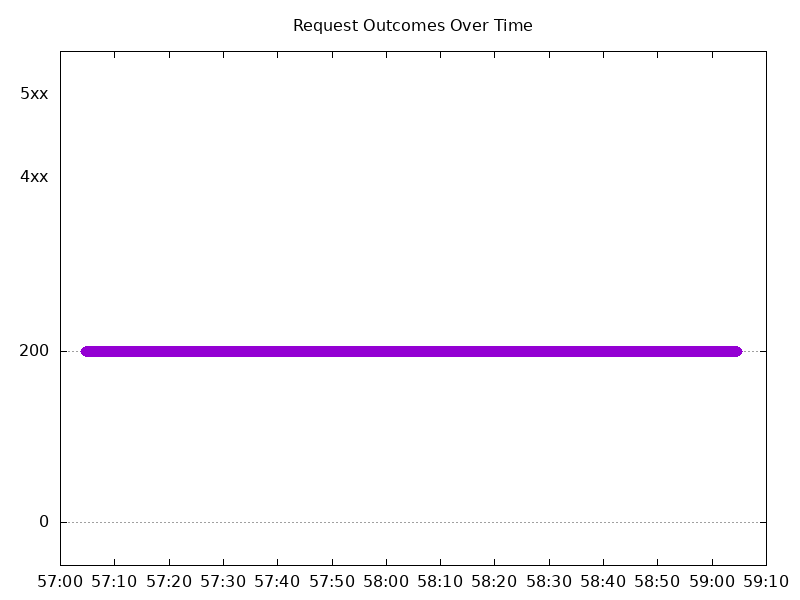

# Results

## Test environment

NGINX Plus: false

NGINX Gateway Fabric:

- Commit: 0042ca1a05b3e6ee63f08f0cf2ca8090a4f6a1e6
- Date: 2026-10-15T15:55:29Z
- Dirty: false

GKE Cluster:

- Node count: 12
- k8s version: v1.36.4-gke.1391002
- vCPUs per node: 16
- RAM per node: 65848244Ki
- Max pods per node: 110
- Zone: us-west1-b
- Instance Type: n2d-standard-16

## One NGINX Pod runs per node Test Results

### Scale Up Gradually

#### Test: Send https /tea traffic

```text
Requests      [total, rate, throughput]         30000, 100.00, 100.00
Duration      [total, attack, wait]             5m0s, 5m0s, 1.13ms
Latencies     [min, mean, 50, 90, 95, 99, max]  658.54µs, 1.05ms, 1.034ms, 1.169ms, 1.214ms, 1.579ms, 17.897ms
Bytes In      [total, mean]                     4655919, 155.20
Bytes Out     [total, mean]                     0, 0.00
Success       [ratio]                           100.00%
Status Codes  [code:count]                      200:30000  
Error Set:
```


#### Test: Send http /coffee traffic

```text
Requests      [total, rate, throughput]         30000, 100.00, 100.00
Duration      [total, attack, wait]             5m0s, 5m0s, 1.143ms
Latencies     [min, mean, 50, 90, 95, 99, max]  624.897µs, 1.007ms, 993.783µs, 1.133ms, 1.184ms, 1.603ms, 17.57ms
Bytes In      [total, mean]                     4835900, 161.20
Bytes Out     [total, mean]                     0, 0.00
Success       [ratio]                           100.00%
Status Codes  [code:count]                      200:30000  
Error Set:
```



### Scale Down Gradually

#### Test: Send http /coffee traffic

```text
Requests      [total, rate, throughput]         48000, 100.00, 100.00
Duration      [total, attack, wait]             8m0s, 8m0s, 1.032ms
Latencies     [min, mean, 50, 90, 95, 99, max]  636.672µs, 1.024ms, 1.012ms, 1.157ms, 1.206ms, 1.453ms, 39.474ms
Bytes In      [total, mean]                     7737736, 161.20
Bytes Out     [total, mean]                     0, 0.00
Success       [ratio]                           100.00%
Status Codes  [code:count]                      200:48000  
Error Set:
```


#### Test: Send https /tea traffic

```text
Requests      [total, rate, throughput]         48000, 100.00, 100.00
Duration      [total, attack, wait]             8m0s, 8m0s, 1.038ms
Latencies     [min, mean, 50, 90, 95, 99, max]  650.909µs, 1.069ms, 1.054ms, 1.195ms, 1.245ms, 1.495ms, 40.946ms
Bytes In      [total, mean]                     7449541, 155.20
Bytes Out     [total, mean]                     0, 0.00
Success       [ratio]                           100.00%
Status Codes  [code:count]                      200:48000  
Error Set:
```



### Scale Up Abruptly

#### Test: Send http /coffee traffic

```text
Requests      [total, rate, throughput]         12000, 100.01, 100.01
Duration      [total, attack, wait]             2m0s, 2m0s, 1.018ms
Latencies     [min, mean, 50, 90, 95, 99, max]  683.787µs, 1.071ms, 1.045ms, 1.201ms, 1.249ms, 1.482ms, 62.996ms
Bytes In      [total, mean]                     1934418, 161.20
Bytes Out     [total, mean]                     0, 0.00
Success       [ratio]                           100.00%
Status Codes  [code:count]                      200:12000  
Error Set:
```



#### Test: Send https /tea traffic

```text
Requests      [total, rate, throughput]         12000, 100.01, 100.01
Duration      [total, attack, wait]             2m0s, 2m0s, 1.013ms
Latencies     [min, mean, 50, 90, 95, 99, max]  671.207µs, 1.096ms, 1.072ms, 1.212ms, 1.261ms, 1.54ms, 62.641ms
Bytes In      [total, mean]                     1862425, 155.20
Bytes Out     [total, mean]                     0, 0.00
Success       [ratio]                           100.00%
Status Codes  [code:count]                      200:12000  
Error Set:
```


### Scale Down Abruptly

#### Test: Send https /tea traffic

```text
Requests      [total, rate, throughput]         12000, 100.01, 100.01
Duration      [total, attack, wait]             2m0s, 2m0s, 1.366ms
Latencies     [min, mean, 50, 90, 95, 99, max]  700.446µs, 1.098ms, 1.088ms, 1.229ms, 1.275ms, 1.398ms, 26.898ms
Bytes In      [total, mean]                     1862399, 155.20
Bytes Out     [total, mean]                     0, 0.00
Success       [ratio]                           100.00%
Status Codes  [code:count]                      200:12000  
Error Set:
```


#### Test: Send http /coffee traffic

```text
Requests      [total, rate, throughput]         12000, 100.01, 100.01
Duration      [total, attack, wait]             2m0s, 2m0s, 1.174ms
Latencies     [min, mean, 50, 90, 95, 99, max]  691.542µs, 1.052ms, 1.047ms, 1.193ms, 1.238ms, 1.344ms, 26.814ms
Bytes In      [total, mean]                     1934410, 161.20
Bytes Out     [total, mean]                     0, 0.00
Success       [ratio]                           100.00%
Status Codes  [code:count]                      200:12000  
Error Set:
```



## Multiple NGINX Pods run per node Test Results

### Scale Up Gradually

#### Test: Send https /tea traffic

```text
Requests      [total, rate, throughput]         30000, 100.00, 100.00
Duration      [total, attack, wait]             5m0s, 5m0s, 921.336µs
Latencies     [min, mean, 50, 90, 95, 99, max]  672.734µs, 1.085ms, 1.065ms, 1.221ms, 1.281ms, 1.719ms, 24.271ms
Bytes In      [total, mean]                     4656087, 155.20
Bytes Out     [total, mean]                     0, 0.00
Success       [ratio]                           100.00%
Status Codes  [code:count]                      200:30000  
Error Set:
```



#### Test: Send http /coffee traffic

```text
Requests      [total, rate, throughput]         30000, 100.00, 100.00
Duration      [total, attack, wait]             5m0s, 5m0s, 1.18ms
Latencies     [min, mean, 50, 90, 95, 99, max]  560.75µs, 1.041ms, 1.025ms, 1.176ms, 1.229ms, 1.72ms, 25.466ms
Bytes In      [total, mean]                     4835932, 161.20
Bytes Out     [total, mean]                     0, 0.00
Success       [ratio]                           100.00%
Status Codes  [code:count]                      200:30000  
Error Set:
```


### Scale Down Gradually

#### Test: Send https /tea traffic

```text
Requests      [total, rate, throughput]         96000, 100.00, 100.00
Duration      [total, attack, wait]             16m0s, 16m0s, 1.224ms
Latencies     [min, mean, 50, 90, 95, 99, max]  657.616µs, 1.09ms, 1.064ms, 1.21ms, 1.267ms, 1.615ms, 60.204ms
Bytes In      [total, mean]                     14899078, 155.20
Bytes Out     [total, mean]                     0, 0.00
Success       [ratio]                           100.00%
Status Codes  [code:count]                      200:96000  
Error Set:
```


#### Test: Send http /coffee traffic

```text
Requests      [total, rate, throughput]         96000, 100.00, 100.00
Duration      [total, attack, wait]             16m0s, 16m0s, 870.92µs
Latencies     [min, mean, 50, 90, 95, 99, max]  643.546µs, 1.037ms, 1.017ms, 1.162ms, 1.214ms, 1.528ms, 76.663ms
Bytes In      [total, mean]                     15475035, 161.20
Bytes Out     [total, mean]                     0, 0.00
Success       [ratio]                           100.00%
Status Codes  [code:count]                      200:96000  
Error Set:
```



### Scale Up Abruptly

#### Test: Send https /tea traffic

```text
Requests      [total, rate, throughput]         12000, 100.01, 100.01
Duration      [total, attack, wait]             2m0s, 2m0s, 1.207ms
Latencies     [min, mean, 50, 90, 95, 99, max]  706.482µs, 1.12ms, 1.052ms, 1.18ms, 1.223ms, 1.535ms, 143.858ms
Bytes In      [total, mean]                     1862529, 155.21
Bytes Out     [total, mean]                     0, 0.00
Success       [ratio]                           100.00%
Status Codes  [code:count]                      200:12000  
Error Set:
```



#### Test: Send http /coffee traffic

```text
Requests      [total, rate, throughput]         12000, 100.01, 100.01
Duration      [total, attack, wait]             2m0s, 2m0s, 982.649µs
Latencies     [min, mean, 50, 90, 95, 99, max]  653.435µs, 1.049ms, 1.005ms, 1.138ms, 1.183ms, 1.554ms, 44.743ms
Bytes In      [total, mean]                     1934349, 161.20
Bytes Out     [total, mean]                     0, 0.00
Success       [ratio]                           100.00%
Status Codes  [code:count]                      200:12000  
Error Set:
```


### Scale Down Abruptly

#### Test: Send http /coffee traffic

```text
Requests      [total, rate, throughput]         12000, 100.01, 100.01
Duration      [total, attack, wait]             2m0s, 2m0s, 1.06ms
Latencies     [min, mean, 50, 90, 95, 99, max]  612.097µs, 1.03ms, 1.028ms, 1.168ms, 1.211ms, 1.308ms, 3.275ms
Bytes In      [total, mean]                     1934314, 161.19
Bytes Out     [total, mean]                     0, 0.00
Success       [ratio]                           100.00%
Status Codes  [code:count]                      200:12000  
Error Set:
```


#### Test: Send https /tea traffic

```text
Requests      [total, rate, throughput]         12000, 100.01, 100.01
Duration      [total, attack, wait]             2m0s, 2m0s, 1.039ms
Latencies     [min, mean, 50, 90, 95, 99, max]  722.58µs, 1.088ms, 1.079ms, 1.213ms, 1.256ms, 1.361ms, 10.125ms
Bytes In      [total, mean]                     1862416, 155.20
Bytes Out     [total, mean]                     0, 0.00
Success       [ratio]                           100.00%
Status Codes  [code:count]                      200:12000  
Error Set:
```


